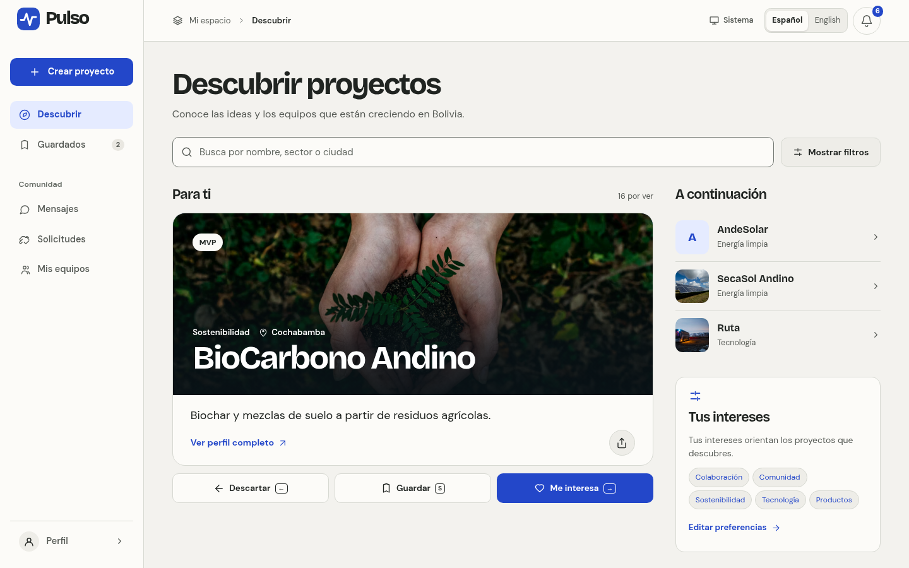
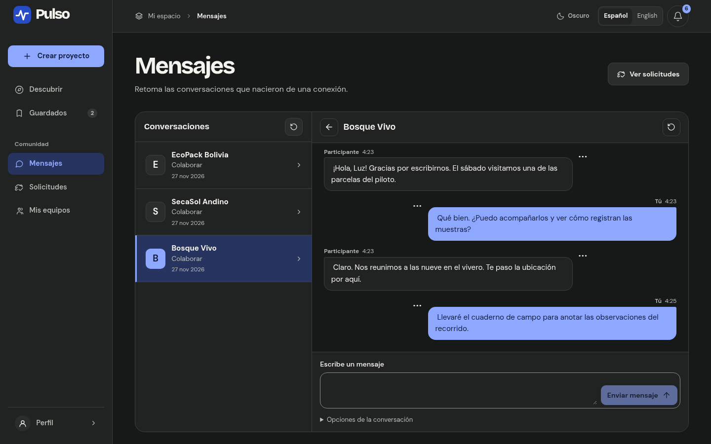

# Capturas de Pulso

Interfaz en Chromium con cuentas ficticias sobre Spring, PostgreSQL y Supabase Auth locales. Las capturas de escritorio tienen 1440 × 900 px. Las de móvil tienen 390 px de ancho. La captura de preferencias muestra la página completa.

| Recorrido | Capturas |
| --- | --- |
| Acceso y alta | [Iniciar sesión · claro](acceso-claro.png) · [Crear cuenta · oscuro](registro-oscuro.png) |
| Preferencias, perfil y administración | [Preferencias · móvil](preferencias-movil.png) · [Mi perfil · claro](perfil-claro.png) · [Administración · oscuro](administracion-oscuro.png) |
| Descubrir, buscar y guardar | [Descubrir · claro](descubrir-claro.png) · [Descubrir · oscuro](descubrir-oscuro.png) · [Descubrir · móvil](descubrir-movil.png) · [Búsqueda y filtros](buscar-claro.png) · [Guardados](guardados-claro.png) |
| Proyectos y equipos | [Ficha pública](detalle-claro.png) · [Crear proyecto](crear-proyecto.png) · [Mis equipos · oscuro](equipos-oscuro.png) · [Gestionar equipo · móvil](gestion-movil.png) · [Invitación · móvil](invitacion-claro.png) |
| Conversaciones y actividad | [Mensajes · escritorio](mensajes-oscuro.png) · [Chat · móvil](chat-movil.png) · [Solicitudes](solicitudes-claro.png) · [Avisos](avisos-oscuro.png) |
